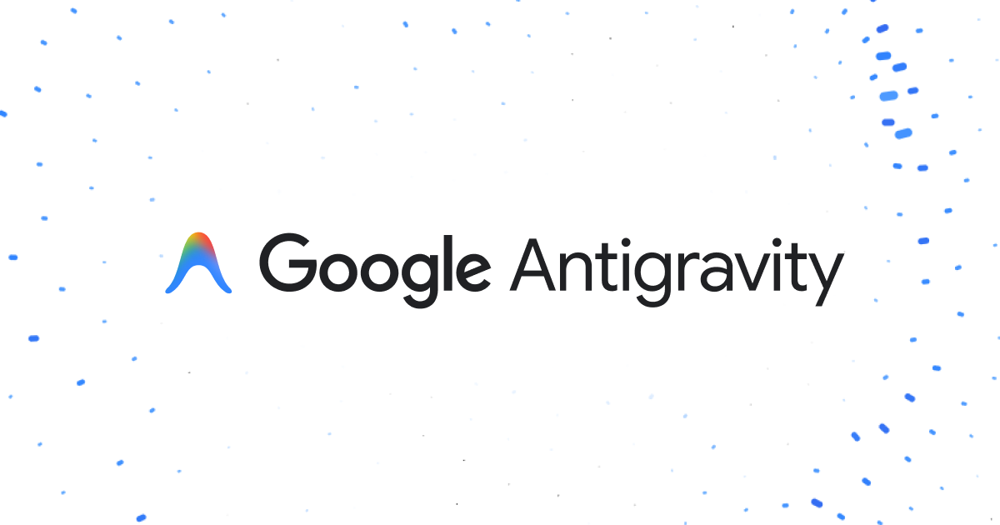

<p align="center">
  
</p>

<p align="center"><sub>Banner: <a href="https://antigravity.google/">Google Antigravity</a>. This is an independent project.</sub></p>

<h1 align="center">do-it-gemini</h1>

<p align="center">A persistent CMD mini chat with 21 engineering and design skills across four plugin packs.</p>

<p align="center">
  <a href="https://www.npmjs.com/package/do-it-gemini"></a>
  <a href="https://nodejs.org/"></a>
  <a href="LICENSE"></a>
  <a href="#skills-and-plugin-packs"></a>
  <a href="#skills-and-plugin-packs"></a>
  <a href="https://github.com/Kuloka/do-it-gemini"></a>
</p>

An unofficial wrapper for Antigravity CLI (`agy`), eligible Gemini CLI installations,
and the Gemini API. It adapts practical Codex/oh-my-codex workflows into native skill
instructions, keeps your chat history on disk, and runs in your current terminal.
This project is not affiliated with or endorsed by Google.

## Quick start

Install **Node.js 20 or newer**, open Windows CMD, and run:

```cmd
npx -y do-it-gemini@latest
```

The published npm package starts `bootstrap`: it prepares a persistent workspace
and opens the mini chat. Existing authenticated Antigravity installations are
discovered automatically, including `%USERPROFILE%\.gemini\bin\agy.exe`, and reuse
their supported credential cache. No new login is needed while that authentication
remains valid. If Antigravity is missing on Windows, bootstrap uses Google's official
installer with `--skip-aliases` and `--skip-path`, then asks you to sign in only when
needed. Complete first-time onboarding in the same terminal and enter `/quit` to
return to the mini chat. Other platforms require an existing supported provider.

Provider requests run without a shell and suppress extra child console windows.
Interactive native mode inherits your current console. The wrapper does not copy
OAuth secrets between providers. You do not need an npm account or npm 2FA to
install the package; publication authentication is for maintainers only.

Google ended personal Gemini CLI access on June 18, 2026. Use Antigravity for
personal access; legacy Gemini CLI requires eligible organization access or paid
API keys. See [Google's transition announcement](https://developers.googleblog.com/an-important-update-transitioning-gemini-cli-to-antigravity-cli/)
and the [official Antigravity installation guide](https://antigravity.google/docs/cli/install/).

## Shell commands

### Graphical Antigravity App panel

Install a small native panel with **context usage** and **remaining model quota**:

```cmd
npx -y do-it-gemini@latest app install
```

In Antigravity App, open **Overview > Plugins > Usage**; enable it in
Customizations if needed. Tested in App 2.24.0. Restart the Usage sidecar after
updates. If a new installation does not appear, restart the App.

Readings come from local App metadata; unavailable values show `—`. The limit is
for the last invocation's model, not a combined account percentage. Internal App
read APIs can change between releases. [Installation, meanings and compatibility](docs/app-usage-panel.md).

Use either the `do-it-gemini` executable or its `gmini` alias. To run an explicit
command without a global installation:

```cmd
npx --yes --package=do-it-gemini@latest -- do-it-gemini help
npx --yes --package=do-it-gemini@latest -- gmini chat --session work
npx --yes --package=do-it-gemini@latest -- gmini ask "Explain this project" --skill analyze
```

In the table below, prepend `do-it-gemini` or `gmini` when the command is installed
or available in your PATH. In a source checkout, use `gmini.cmd` instead.

| Command | What it does |
|---|---|
| `help` | Show commands and options |
| `chat` | Open the wrapper's persistent mini chat |
| `ask "message"` | Send one request and save the completed conversation turn |
| `native` | Open the selected native CLI interactively in the current console |
| `setup` | Prepare data, workspace context, skills, and Gemini custom commands |
| `setup --global` | Also install skills in the user folders of Gemini and Antigravity |
| `app install` | Install or update the graphical Antigravity App usage panel |
| `setup --install-cli` | Also install legacy Gemini CLI 0.63.0 locally; supported legacy access is required |
| `bootstrap` | Prepare the workspace, install Antigravity on Windows if needed, and open chat |
| `doctor` | Report data paths, skill/plugin counts, and discovered providers |
| `skills` | List skills enabled by the active plugin packs |
| `plugins` | List plugin packs and their enabled status |
| `plugins enable NAME` | Enable an instruction pack in the mini chat |
| `plugins disable NAME` | Disable an instruction pack in the mini chat |
| `sessions` | List saved wrapper chat sessions |

With no subcommand, npm installations run `bootstrap`; a source checkout opens
`chat`. `ask` supports scripted requests, while `chat` and `bootstrap` require an
interactive terminal.

### Options

| Option | Purpose |
|---|---|
| `--session NAME` | Choose a saved conversation; default: `default` |
| `--model MODEL` | Use a provider-supported model for the command |
| `--provider auto\|agy\|cli\|api` | Choose automatic discovery, Antigravity, legacy Gemini CLI, or API mode |
| `--data PATH` | Override the wrapper's data directory |
| `--workspace PATH` | Choose the project directory used by native tools |
| `--skill NAME` | Explicitly select an enabled skill for a request or chat |
| `--help` | Show help |
| `--install-cli` | Install legacy Gemini CLI when used with `setup` |
| `--global` | Install native skills globally when used with `setup` |

`auto` prefers discovered Antigravity, then legacy Gemini CLI, then API access.
Bootstrap uses API mode directly when `GEMINI_API_KEY` is set. Use `--provider agy`
for an explicit Antigravity chat or `--provider cli` for eligible legacy access.
`GMINI_AGY_PATH` selects an Antigravity executable, `GMINI_CLI_PATH` selects a
Gemini CLI JavaScript entrypoint, and `GMINI_DATA_DIR` overrides the data directory.

## Chat commands

| Command | Action |
|---|---|
| `/help` | Show available commands |
| `/skills` | List enabled skills |
| `/skill NAME` | Select a skill for subsequent messages |
| `/skill auto` | Restore task-based skill selection |
| `/plugins` | Show enabled plugin packs |
| `/sessions` | List saved sessions |
| `/session NAME` | Switch to or continue a session |
| `/new [NAME]` | Create a separate session, optionally with a chosen name |
| `/history` | Print the current conversation history |
| `/model` or `/ model` | Show available native models and enter a model ID |
| `/model NAME` or `/ model NAME` | Change the model and save the choice |
| `/model list` | Show the current model and available Antigravity models |
| `/model default` | Reset to the provider's default model |
| `/exit` or `/quit` | Leave the mini chat |

Write `$plan task description` or `$analyze question` in a message to explicitly
select a skill for that turn. Native Gemini workspace setup also installs
`/gmini:<skill-name>` commands, such as `/gmini:plan`. These are native CLI commands,
not wrapper mini-chat slash commands.

## Skills and plugin packs

All four packs are enabled by default. Plugins are declarative instruction packs,
not arbitrary JavaScript executables or automatically connected external services.

| Pack | Included skills |
|---|---|
| **developer** | [plan](skills/plan/SKILL.md), [deep-interview](skills/deep-interview/SKILL.md), [ralplan](skills/ralplan/SKILL.md), [autopilot](skills/autopilot/SKILL.md), [ultragoal](skills/ultragoal/SKILL.md), [design](skills/design/SKILL.md), [wiki](skills/wiki/SKILL.md), [skill-creator](skills/skill-creator/SKILL.md), [skill-manager](skills/skill-manager/SKILL.md), [doctor](skills/doctor/SKILL.md), [cancel](skills/cancel/SKILL.md), [team](skills/team/SKILL.md) |
| **quality** | [code-review](skills/code-review/SKILL.md), [ai-slop-cleaner](skills/ai-slop-cleaner/SKILL.md), [ultraqa](skills/ultraqa/SKILL.md), [performance-goal](skills/performance-goal/SKILL.md) |
| **research** | [analyze](skills/analyze/SKILL.md), [best-practice-research](skills/best-practice-research/SKILL.md) |
| **design** | [design](skills/design/SKILL.md), [frontend-design](skills/frontend-design/SKILL.md), [design-system](skills/design-system/SKILL.md), [design-review](skills/design-review/SKILL.md) |

The developer pack also includes these four design skills so existing installations
gain the expanded workflows when updated. Shared skills load once.

Use developer workflows for requirements, plans, implementation, and maintained
project knowledge; quality workflows for review, cleanup, adversarial QA, and measured
optimization; research workflows for evidence-backed investigation and current guidance.
Delegation and independent review depend on actual native provider capabilities.
Solo review passes are labeled self-review; skills do not invent missing runtime tools.

### Design workflows

Choose the skill that matches the result you need:

| Skill | Result |
|---|---|
| `design` | Product-specific direction, hierarchy, visual language and a buildable design contract; continues into implementation when requested |
| `frontend-design` | Working interface with deliberate typography, layout, real interaction states and responsive behavior |
| `design-system` | Semantic tokens and reusable components that fit the existing product |
| `design-review` | Ranked visual and usability findings, evidence and concrete corrections |

```text
/skill frontend-design
Build a seed-library website with inventory search and a workshop signup demo.
/skill design-review
Review the current page at desktop and mobile widths. Fix the highest-impact issues.
```

In native Gemini or Antigravity, ask explicitly to use the installed skill. Gemini
workspace setup also provides `/gmini:frontend-design` and `/gmini:design-review`.
Resources cover composition, typography, color, imagery, design tokens, reflow,
focus, keyboard interaction and browser QA. Required references are included in
explicit wrapper requests, including API mode.

Browser and image tools depend on the active host and its permissions. Antigravity
CLI/App browser delegation requires explicit `/browser` activation; a skill cannot
grant it. API-only mode can provide code and critique supplied evidence, but cannot
render or operate a browser. See [native capabilities](skills/design/references/native-capabilities.md).

## Providers and limits

Antigravity requests use streamJSON over stdin; legacy Gemini CLI uses headless
JSON requests. Both retain their native authentication, workspace trust, and tool
approval rules. Some operations can require interactive `native` mode.

For API-only chat:

```cmd
set "GEMINI_API_KEY=your-key"
npx --yes --package=do-it-gemini@latest -- gmini chat --provider api --model gemini-3.8-flash
```

API mode has **no filesystem, shell, browser, or subagent tools**. The key is read
from the environment and is not saved in configuration. Provider requests send
selected instructions and conversation history to Google and are subject to your
account's access, usage limits, and billing. The full wrapper conversation is sent
with every request; use `/new` to keep unrelated tasks and long histories separate.

## Storage and your own project

The terminal interface is in English. Model responses follow your request's language.
Bootstrap also installs native skills and their resources into:

- `%USERPROFILE%\.gemini\skills` — Gemini CLI.
- `%USERPROFILE%\.gemini\antigravity-cli\skills` — Antigravity CLI.
- `%USERPROFILE%\.gemini\config\skills` — Antigravity App and IDE.

They are available when you launch the corresponding native product separately.
Unchanged managed files and recognized 0.1.2 skills update safely; user-edited or
unrecognized conflicting files stop installation before replacement. Receipts track
installed content without touching authentication. Restart the native session after
updating so it can discover new skills. To install or update explicitly:

```cmd
npx --yes --package=do-it-gemini@latest -- gmini setup --global
```

For npm/npx on Windows:

```text
%LOCALAPPDATA%\do-it-gemini\data\
  config.json           enabled packs, model, workspace
  sessions\*.json       completed conversation turns and timestamps
  workflows\            workflow evidence and artifacts
  runtime\              optional local legacy CLI installation
%LOCALAPPDATA%\do-it-gemini\workspace\
```

Data survives npx cache changes and does not depend on the CMD working directory.
Only successful completed turns are saved; corrupt JSON raises an explicit error.
Native providers manage their own credentials and additional sessions separately.

To launch against an existing project:

```cmd
npx -y do-it-gemini@latest --workspace "D:\Projects\my-app"
```

Setup preserves existing `GEMINI.md` text, adds a context import, and copies skills
with their resources to `.gemini/skills` for Gemini and `.agents/skills` for
Antigravity. It checks conflicts before writing and refuses to overwrite modified
context, skills, or commands. Disabling a wrapper pack does not delete installed
native skills; manage those with the appropriate native CLI.

## Source checkout and extension setup

From a local checkout, run:

```cmd
setup.cmd
gmini.cmd native
gmini.cmd chat --session work
```

Source checkouts default to the repository's `data/` directory. The local `.cmd`
launchers do not require `npm link` or depend on PowerShell ExecutionPolicy.
Optionally use `npm.cmd link` for a persistent executable in your npm prefix.

For eligible Gemini CLI users, the repository also supports extension installation:

```cmd
gemini extensions install "C:\Projects\do-it-gemini"
```

Replace the path with your checkout. Avoid combining extension installation and
workspace setup in the same project, which can duplicate skills and commands.

## Development and documentation

```cmd
npm.cmd test
npm.cmd run check
```

Tests cover persistence, provider protocols, errors, plugin selection, subprocess
launching, resource inclusion, managed upgrades and workspace setup without paid
API calls. The check validates syntax, manifests, provenance and bundled resource
links. The wrapper has no third-party runtime
libraries; installed native providers are separate products.

See [the full usage manual](docs/usage.md) for detailed provider behavior, custom
plugin setup, configuration, and official references, and [PUBLISH.md](PUBLISH.md)
for maintainer publication instructions. Adaptation provenance is recorded in
[skills/catalog.json](skills/catalog.json); OMX procedures derive from
oh-my-codex 0.21.9 (MIT, Yeachan-Heo).

[GitHub](https://github.com/Kuloka/do-it-gemini) · [npm](https://www.npmjs.com/package/do-it-gemini)
